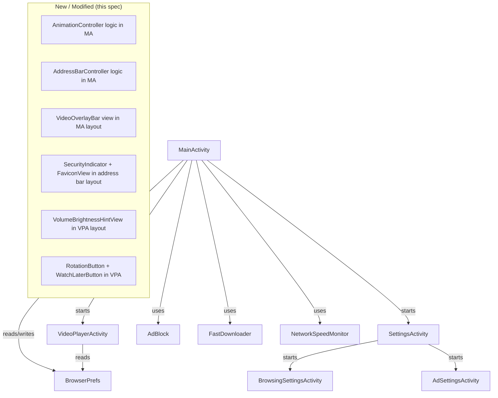

# Design Document

## Overview

This design covers eight UC Browser feature replications added to the Blaze Browser Android application. All work is in Java and Android XML. No new Gradle dependencies are introduced; the implementation reuses the existing MediaStore, AndroidX AppCompat, Media3 ExoPlayer, and Android SDK APIs already on the classpath.

The features divide into four concern areas:

| Concern | Features |
|---|---|
| Visual chrome & theming | R1 (animations), R2 (orange colour), R3 (dark mode) |
| Browsing ergonomics | R4 (address bar scroll hide), R6 (favicon/security) |
| Video player | R5 (player UX improvements) |
| Settings & overlays | R7 (enhanced settings), R8 (video overlay bar) |

---

## Architecture

The app follows a single-`Activity` + helper-class pattern for the browser core, with separate `Activity` classes for the video player and settings screens. There is no ViewModel layer — state is held in instance variables and persisted via `BrowserPrefs` (`SharedPreferences`).



All new preferences are added to `BrowserPrefs.java`. All new UI toggles are added to `BrowsingSettingsActivity` and `SettingsActivity`. No new `Activity` classes are needed.

---

## Components and Interfaces

### 1. AnimationController (inline in MainActivity / all Activities)

Animations are applied using `overridePendingTransition(enterAnim, exitAnim)` after every `startActivity()` / `finish()` call. Six XML animation resources are added under `res/anim/`.

| File | Effect | From UC |
|---|---|---|
| `anim/slide_in_right.xml` | `translateX` 100%→0%, 250 ms | `u4_slide_in_from_right` |
| `anim/slide_out_left.xml` | `translateX` 0%→-30%, 250 ms | `u4_window_zoom_out` (pair) |
| `anim/slide_in_left.xml` | `translateX` -30%→0%, 250 ms | `u4_window_zoom_in` (pair) |
| `anim/slide_out_right.xml` | `translateX` 0%→100%, 250 ms | `u4_slide_out_to_right` |
| `anim/zoom_in.xml` | `scale` 0.9→1.0, 250 ms | `u4_window_zoom_in` |
| `anim/zoom_out.xml` | `scale` 1.0→0.9, 250 ms | `u4_window_zoom_out` |

A helper method `startWithAnim(Intent)` wraps `startActivity` + `overridePendingTransition`. A helper `finishWithAnim()` wraps `finish()` + `overridePendingTransition`. Both check `BrowserPrefs.animationsEnabled()` before applying transitions.

### 2. AddressBarController (inline in MainActivity)

The address bar is a `LinearLayout` (`id/address_bar_container`) that wraps the `EditText` and `ProgressBar`. It sits above the `WebView` in a `FrameLayout` parent with `clipChildren=false`.

**Scroll detection via JS bridge:**

```javascript
// Injected on every page load
(function(){
  var last=0;
  window.addEventListener('scroll',function(){
    var y=window.scrollY||document.documentElement.scrollTop;
    if(Math.abs(y-last)>=50){BlazeBridge.onScroll(y);last=y;}
  },true);
})();
```

The `BlazeBridge.onScroll(int scrollY)` Java method (annotated `@JavascriptInterface`) compares `scrollY` to a stored `lastScrollY` field:
- Scroll down >100 px → animate `translationY` to `-barHeightPx` (computed at runtime from the view height)
- Scroll up → animate `translationY` to `0`
- Skip animation if already at the target value (guard with `Math.abs` < 2 px)

The `ObjectAnimator` duration is 200 ms. A reference to the running animator is kept so that a new gesture cancels the previous one (`animator.cancel()` before starting a new one).

On `onPageStarted`, call `addressBarContainer.setTranslationY(0)` directly (no animation needed — page is still loading).

### 3. Dark Mode Chrome (applyChrome in MainActivity)

A new private method `applyChrome(boolean night)` is called in `onResume` and whenever the night-mode switch is toggled via a broadcast or `ActivityResult`:

```java
private void applyChrome(boolean night) {
    int barBg  = night ? 0xFF14181E : 0xFFFFFFFF;
    int navBg  = night ? 0xFF14181E : 0xFFF7F7F8;
    int elemBg = night ? 0xFF1B1B1B : 0xFFFFFFFF;
    int tabBg  = night ? 0xFF14181E : 0xFF222327; // existing tab_bg
    getWindow().setStatusBarColor(barBg);
    getWindow().setNavigationBarColor(navBg);
    addressBarContainer.setBackgroundColor(elemBg);
    bottomNav.setBackgroundColor(elemBg);
    tabsPanel.setBackgroundColor(tabBg);
}
```

### 4. SecurityIndicator + FaviconView (address bar layout)

The address bar `LinearLayout` gains two prepended children:

```
[FaviconView 20dp] [SecurityIndicator 16dp] [EditText flex] [ProgressBar]
```

`FaviconView` is a standard `ImageView` with `scaleType=centerCrop`.  
`SecurityIndicator` is a standard `ImageView` with two vector drawables: `ic_lock_green.xml` and `ic_warning_orange.xml` (added to `res/drawable/`).

Favicon loading uses a background thread (plain `Thread` + `HttpURLConnection`) to fetch the Google favicon service URL. The result bitmap is posted back to the main thread via `runOnUiThread`. The 3 000 ms timeout is applied to `HttpURLConnection.setConnectTimeout(3000)` and `setReadTimeout(3000)`.

### 5. VolumeBrightnessHintView (VideoPlayerActivity layout)

A new `LinearLayout` overlay added to the `FrameLayout` root of `activity_player.xml`, centred using `layout_gravity="center"`. It has:
- `ImageView` (`id/hint_icon`) — shows `ic_volume_up` or `ic_brightness_medium` depending on the swipe axis
- `ProgressBar` horizontal style, `max=100`, `id/hint_progress`
- Background: a rounded rectangle `ShapeDrawable` with `#CC000000` fill (80% opaque black) created programmatically or via `res/drawable/hint_bg.xml`

Existing gesture handling in `VideoPlayerActivity.onTouchEvent` already distinguishes left/right swipe halves for volume/brightness. The `hint` `TextView` (existing `id/hint`) is replaced by this view. The `Handler.postDelayed(hideHint, 1000)` pattern used for the existing `hint` is reused.

### 6. Rotation Button + Watch Later Button (VideoPlayerActivity)

Two `ImageButton` views are added to the bottom controls `LinearLayout` in `activity_player.xml`:

- `btn_rotate` — uses `ic_screen_rotation` drawable; cycles `requestedOrientation` between `PORTRAIT`, `LANDSCAPE`, `SENSOR`. Icon updates: lock-portrait, lock-landscape, auto-rotate system icon.
- `btn_watch_later` — uses `ic_bookmark_add` drawable; calls `BrowserPrefs.toggleBookmark(ctx, title, url)` using the `"page_url"` and `"title"` extras from the launch `Intent`.

The three orientation state constants are stored in a `private static final int[] ORIENTATIONS` array; a `rotateIndex` field cycles with `% 3`.

### 7. Seek Bar Touch Lock (VideoPlayerActivity)

The existing `SeekBar.OnSeekBarChangeListener`:
- `onStartTrackingTouch` → set `seeking = true` (field already exists in the class)
- `onStopTrackingTouch` → call `player.seekTo((long) seekBar.getProgress())`, set `seeking = false`
- The existing progress ticker already checks `if (!seeking)` before updating the thumb — this field just needs to be toggled by the listener rather than managed implicitly.

### 8. Enhanced Settings

**New BrowserPrefs methods (all in `BrowserPrefs.java`):**

| Method pair | Key | Default | Notes |
|---|---|---|---|
| `animationsEnabled / setAnimationsEnabled` | `"animations"` | `true` | R1 |
| `autoRotateVideo / setAutoRotateVideo` | `"auto_rotate"` | `false` | R7 |
| `hardwareAccel / setHardwareAccel` | `"hw_accel"` | `true` | R7 |
| `fontSizePercent / setFontSizePercent` | `"font_size"` | `100` | clamped 75–200 |
| `swipeNavEnabled / setSwipeNavEnabled` | `"swipe_nav"` | `true` | R7 |
| `blockImages / setBlockImages` | `"block_images"` | `false` | R7 |

`fontSizePercent` clamps the input: `Math.max(75, Math.min(200, value))`.

**BrowsingSettingsActivity layout additions** (`activity_browsing_settings.xml`):
- Row: `Switch` + label "Auto-rotate in video player"
- Row: `Switch` + label "Hardware Acceleration"  
- Row: `TextView` label "Font Size" + `SeekBar` (min=75, max=200, step inferred)
- Row: `Switch` + label "Swipe Forward / Back"
- Row: `Switch` + label "Block Images (Data Saver)"

SeekBar for font size: `android:min="75"` (API ≥ 26) with a fallback offset (`progress = value - 75`) for older API. A `TextView` shows the live percentage value next to the SeekBar.

**SettingsActivity additions** — two new rows before "Clear Records":
- "Clear Cookies" → `CookieManager.getInstance().removeAllCookies(null)` + `Toast`
- "Clear Form Data" → iterate all open tabs and call `webView.clearFormData()` — MainActivity exposes `public List<WebView> getTabs()` (or the list is accessed via a static ref passed by intent result)

Since SettingsActivity has no reference to MainActivity's WebView list, "Clear Form Data" calls `WebView.clearFormData()` on a freshly created dummy `WebView` via `new WebView(context).clearFormData()` is incorrect. Instead, the result is communicated back: `SettingsActivity` starts with `startActivityForResult`, and MainActivity handles `RESULT_CLEAR_FORM_DATA` in `onActivityResult` to iterate tabs.

**MainActivity WebSettings application (on tab creation and on setting change):**

```java
void applyWebSettings(WebView wv) {
    WebSettings s = wv.getSettings();
    s.setTextZoom(BrowserPrefs.fontSizePercent(this));
    s.setBlockNetworkImage(BrowserPrefs.blockImages(this));
    s.setLoadsImagesAutomatically(!BrowserPrefs.blockImages(this));
    if (!BrowserPrefs.hardwareAccel(this))
        wv.setLayerType(View.LAYER_TYPE_SOFTWARE, null);
}
```

This method is called both at WebView creation and when the settings Activity returns a result.

### 9. VideoOverlayBar (MainActivity layout)

Added to `activity_main.xml` inside the `FrameLayout` that contains the `WebView stack`:

```xml
<LinearLayout
    android:id="@+id/video_overlay_bar"
    android:layout_gravity="top|end"
    android:layout_margin="8dp"
    android:orientation="vertical"
    android:visibility="gone"
    android:elevation="4dp"
    android:background="@drawable/overlay_bar_bg">

    <ImageButton android:id="@+id/btn_overlay_pip" ... />
    <ImageButton android:id="@+id/btn_overlay_dl" ... />
    <ImageButton android:id="@+id/btn_overlay_audio" ... />
</LinearLayout>
```

`overlay_bar_bg.xml` — a rounded rectangle drawable with `#BF000000` fill (75% opaque black).

Each button is 36 dp × 36 dp with `background="?android:attr/selectableItemBackgroundBorderless"` and uses system icons (`ic_picture_in_picture`, `ic_file_download`, `ic_volume_off` / `ic_volume_up`).

Visibility is toggled from the existing `playChip` visibility logic. The muted state is a `boolean audioMuted` field; toggling injects JS and swaps the icon between `ic_volume_up` and `ic_volume_off`.

---

## Data Models

### New BrowserPrefs Keys

All keys are stored in the `"blaze"` `SharedPreferences` file alongside existing keys.

| Preference Key | Java Type | Default | Valid Range |
|---|---|---|---|
| `"animations"` | boolean | `true` | — |
| `"auto_rotate"` | boolean | `false` | — |
| `"hw_accel"` | boolean | `true` | — |
| `"font_size"` | int | `100` | 75–200 |
| `"swipe_nav"` | boolean | `true` | — |
| `"block_images"` | boolean | `false` | — |

No schema migration is required. New keys default to their initial values if absent, matching the existing pattern in `BrowserPrefs`.

### Animation Resource Structure

```
res/
  anim/
    slide_in_right.xml    ← translateX +100% → 0%
    slide_out_left.xml    ← translateX 0%   → -30%
    slide_in_left.xml     ← translateX -30% → 0%
    slide_out_right.xml   ← translateX 0%   → +100%
    zoom_in.xml           ← scale 0.9 → 1.0
    zoom_out.xml          ← scale 1.0 → 0.9
```

### Drawable Resources Added

```
res/drawable/
    ic_lock_green.xml         ← vector, green lock path
    ic_warning_orange.xml     ← vector, triangle warning path
    hint_bg.xml               ← shape: rounded rect, fill #CC000000
    overlay_bar_bg.xml        ← shape: rounded rect, fill #BF000000
    ic_rotate_portrait.xml    ← vector rotation icon
    ic_rotate_landscape.xml   ← vector rotation icon
    ic_rotate_auto.xml        ← vector rotation icon
    ic_watch_later.xml        ← vector bookmark-add icon
```

---

## PBT Assessment

This feature set consists entirely of Android UI modifications: activity transitions, view colour assignments, layout visibility toggles, and `SharedPreferences` reads/writes. There are no pure transformation functions with large input spaces, no parsers or serialisers, and no data-structure invariants that vary meaningfully across a randomised input domain.

**Conclusion: Property-based testing is NOT appropriate for this feature.** The Correctness Properties section is omitted. Testing will use example-based unit tests and manual UI verification.

---

## Error Handling

| Scenario | Handling Strategy |
|---|---|
| Favicon HTTP fetch fails (network error, timeout, HTTP 4xx/5xx) | Silently keep the default Blaze "B" logo; no error shown to user |
| Favicon bitmap decode fails (malformed PNG/ICO) | Catch `Exception`, keep default drawable |
| `enterPictureInPictureMode` throws `IllegalStateException` (e.g. app not in foreground) | Catch, show Toast "PiP not available right now" |
| `overridePendingTransition` called on API < 16 | Not applicable — `minSdkVersion` is already ≥ 21 per existing `build.gradle` |
| `setStatusBarColor` / `setNavigationBarColor` on API < 21 | Not applicable — same reason |
| `WebSettings.setTextZoom` receives value outside 75–200 | `BrowserPrefs.setFontSizePercent` clamps before persist; MainActivity applies the clamped value |
| `SeekBar` progress tick fires while `seeking = true` | Guard already in place in ticker; flag flip in `onStartTrackingTouch` closes the race |
| `VideoOverlayBar` visible when no sniffed URL available | `btn_overlay_dl` tap falls through to the same null-guard already protecting the `playChip` download action |

---

## Testing Strategy

**No property-based tests are used** because all acceptance criteria involve UI rendering, system API calls, or `SharedPreferences` toggles — none of which benefit from 100-iteration randomised input.

### Unit Tests (Example-Based)

| Test class | What it covers |
|---|---|
| `BrowserPrefsTest` | `fontSizePercent` clamping (input < 75 → 75, input > 200 → 200, in-range preserved); `animationsEnabled` default `true`; `blockImages` round-trip save/load |
| `AdBlockTest` (existing) | `blockImages` does not affect `AdBlock.isAd()` |

### Instrumented / Manual UI Tests

| Scenario | Pass condition |
|---|---|
| Rotate device while anim pref ON | Slide animation visible during Activity transitions |
| Rotate device while anim pref OFF | No animation during Activity transitions |
| Scroll down on a long page | Address bar slides out of view; content fills screen |
| Scroll up on a long page | Address bar slides back into view |
| Navigate to `https://example.com` | Green lock icon visible; favicon loaded |
| Navigate to `http://example.com` | Orange warning icon visible |
| Night Mode ON, return to browser | Status bar, nav bar, address bar, bottom nav all dark |
| Night Mode OFF | All surfaces revert to light colours |
| Swipe left half of video up/down | Brightness hint overlay visible with icon and progress bar |
| Swipe right half of video up/down | Volume hint overlay visible with icon and progress bar |
| Tap rotate button in video player | Orientation cycles portrait → landscape → sensor |
| Tap Watch Later in video player | Toast confirms bookmark saved |
| Play video, drag SeekBar | Thumb does not jump during drag; seeks on release |
| Open page with detected video | VideoOverlayBar appears at top-right |
| Tap PiP button in overlay | PiP mode activates (API ≥ 26) |
| Tap audio button in overlay | All video elements muted; icon updates |
| Navigate away from video page | VideoOverlayBar disappears |
| Change Font Size to 150% | All open tabs reflow text at 150% zoom |
| Enable Block Images | New pages load without images |
| Clear Cookies | Toast shown; subsequent page loads have no session cookies |
