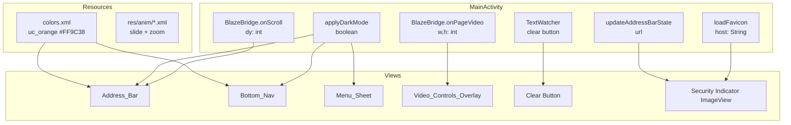

# Design Document: UC Browser Remaining Features

## Overview

This document covers the technical design for six remaining UC Browser UI/UX features not yet present in Blaze Browser
v2.0.0. All changes are scoped to the single-module `blaze-browser` Android project. No new dependencies are added;
the implementation uses only the existing AppCompat, AndroidX, and standard Android SDK APIs already in `build.gradle`.

The six features are:
1. **R1** – UC Browser brand orange color (`#FF9C38`) applied to key interactive elements
2. **R2** – Native dark-mode chrome (address bar, bottom nav, menu sheet darken when Night Mode is on)
3. **R3** – Slide/zoom activity transition animations matching UC Browser's `styles.xml` patterns
4. **R4** – Address bar hide-on-scroll with JS bridge integration
5. **R5** – In-page video controls overlay (PiP, download, audio-only) near detected videos
6. **R6** – Improved address bar with security indicator, favicon, and inline clear button

---

## Architecture

The features map to three implementation layers:

```
┌─────────────────────────────────────────────────────────────────┐
│  Resource Layer (R1, R3)                                        │
│  colors.xml • anim/*.xml • drawables                            │
│  Pure XML edits, no Java changes beyond attribute references    │
├─────────────────────────────────────────────────────────────────┤
│  View-Styling Layer (R2, R6)                                    │
│  applyDarkMode(boolean)  •  updateAddressBarState(String url)   │
│  loadFavicon(String url) •  TextWatcher for clear button        │
│  Reads BrowserPrefs / current URL; applies colors/drawables     │
├─────────────────────────────────────────────────────────────────┤
│  JS-Bridge + View-Management Layer (R4, R5)                     │
│  BlazeBridge.onScroll(int dy) → animateAddressBar()             │
│  BlazeBridge.onPageVideo(w, h) → showVideoOverlay()             │
│  scroll.js injected into each WebView alongside sniff.js        │
└─────────────────────────────────────────────────────────────────┘
```

All new Java logic lives in `MainActivity.java`. No new Activity classes are introduced.



---

## Components and Interfaces

### R1: Color Resources

**File:** `res/values/colors.xml`

Add one new color:
```xml
<color name="uc_orange">#FF9C38</color>
```

Update the following attributes to reference `@color/uc_orange` instead of their current blue values:

| Element | Attribute | Current | New |
|---|---|---|---|
| `activity_main.xml` → `@id/progress` | `android:progressTint` | `@color/primary` | `@color/uc_orange` |
| `video_sniff_bar.xml` → `@id/sniff_bar_play` | `android:background` | `#441A73E8` | `#CCFF9C38` |
| `video_sniff_bar.xml` → `@id/sniff_bar_download` | `android:background` | `#441A73E8` | `#CCFF9C38` |
| `play_chip.xml` drawable | `android:color` fill | current blue | `@color/uc_orange` |
| `activity_main.xml` → `@id/dl_speed_badge` | `android:textColor` | `@color/primary` | `@color/uc_orange` |

---

### R2: Native Dark Mode Chrome

**File:** `res/values/themes.xml` — add `Theme.Blaze.Dark`

```xml
<style name="Theme.Blaze.Dark" parent="Theme.AppCompat.NoActionBar">
    <item name="colorPrimary">#FF9C38</item>
    <item name="android:statusBarColor">@android:color/transparent</item>
    <item name="android:navigationBarColor">#1B1B1B</item>
    <item name="android:windowBackground">#121212</item>
    <item name="android:windowLightStatusBar">false</item>
    <item name="android:windowDrawsSystemBarBackgrounds">true</item>
</style>
```

**File:** `MainActivity.java` — new method `applyDarkMode(boolean dark)`

This method is called:
- At the end of `onCreate()` after view binding: `applyDarkMode(BrowserPrefs.nightMode(this))`
- Immediately when the Night Mode toggle is tapped in the menu sheet (before `hideMenuSheet()`)

```
applyDarkMode(dark):
  addressBarBg  = dark ? #1B1B1B : #FFFFFF
  bottomNavBg   = dark ? #1B1B1B : bottomNavBgDefault   // retain drawable reference for light
  menuSheetBg   = dark ? #242424 : #FFFFFF
  textColor     = dark ? #E0E0E0 : #16181C   (color/ink)
  hintColor     = dark ? #888888 : #66707A   (color/muted)
  iconTint      = dark ? Color.WHITE : Color.TRANSPARENT  // tintMode SRC_ATOP

  addressBar.setBackgroundColor(addressBarBg)
  address.setTextColor(textColor)
  address.setHintTextColor(hintColor)
  bottomNav.setBackgroundColor(bottomNavBg)
  // For each ImageButton in bottomNav: setColorFilter(iconTint, SRC_ATOP)
  menuPanel.setBackgroundColor(menuSheetBg)

  // Status bar: set light/dark status bar icons via WindowInsetsController
  WindowCompat.getInsetsController(window, window.decorView)
              .setAppearanceLightStatusBars(!dark)
```

The approach is programmatic (no Activity recreation), so the UI updates in-place with no flicker.

---

### R3: Activity Slide Animations

**New files in `res/anim/`:**

| File | Effect | Key parameters |
|---|---|---|
| `slide_in_from_right.xml` | Translate X: +100% → 0% | duration 250 ms, `AccelerateDecelerateInterpolator` |
| `slide_out_to_right.xml` | Translate X: 0% → +100% | duration 250 ms |
| `window_zoom_out.xml` | Scale 1.0→0.95, alpha 1.0→0.85 | duration 250 ms |
| `window_zoom_in.xml` | Scale 0.95→1.0, alpha 0.85→1.0 | duration 250 ms |

```xml
<!-- slide_in_from_right.xml -->
<set xmlns:android="http://schemas.android.com/apk/res/android"
     android:interpolator="@android:anim/accelerate_decelerate_interpolator">
    <translate android:fromXDelta="100%" android:toXDelta="0%"
               android:duration="250"/>
</set>

<!-- window_zoom_out.xml (MainActivity exits when VideoPlayer enters) -->
<set xmlns:android="http://schemas.android.com/apk/res/android">
    <scale android:fromXScale="1.0" android:toXScale="0.95"
           android:fromYScale="1.0" android:toYScale="0.95"
           android:pivotX="50%" android:pivotY="50%"
           android:duration="250"/>
    <alpha android:fromAlpha="1.0" android:toAlpha="0.85" android:duration="250"/>
</set>
```

**Call sites in `MainActivity.java`** — after every `startActivity()`:

```java
// Starting VideoPlayerActivity, SettingsActivity, DownloadsActivity, etc.
startActivity(intent);
overridePendingTransition(R.anim.slide_in_from_right, R.anim.window_zoom_out);
```

**In each secondary Activity** (Settings, Downloads, AdSettings, BrowsingSettings) — override `finish()`:

```java
@Override
public void finish() {
    super.finish();
    overridePendingTransition(R.anim.window_zoom_in, R.anim.slide_out_to_right);
}
```

---

### R4: Address Bar Hide-on-Scroll

#### JavaScript Side — `res/assets/www/scroll.js` (new file)

Injected immediately after `sniff.js` via `evaluateJavascript` in `WebViewClient.onPageFinished`.

```javascript
(function () {
  if (window.__blazeScroll) return;
  window.__blazeScroll = true;
  var lastTop = 0;
  window.addEventListener('scroll', function () {
    var top = window.scrollY || document.documentElement.scrollTop || 0;
    var dy = top - lastTop;
    lastTop = top;
    try { BlazeBridge.onScroll(Math.round(dy * window.devicePixelRatio)); } catch (e) {}
  }, { passive: true });
})();
```

The `dy` value is converted to physical pixels (matching `dpToPx` scale on the Java side) by multiplying by `devicePixelRatio`.

#### Java Side — `MainActivity.java`

New fields:
```java
private int   scrollAccumulator   = 0;   // px accumulated downward since last reset
private boolean addressBarHidden  = false;
private View  addressBarView;            // reference to @id/address_bar
private int   addressBarHeight;          // measured in px, set in onCreate
```

New `@JavascriptInterface` method on `BlazeBridge`:
```java
@JavascriptInterface
public void onScroll(int dy) {
    mainHandler.post(() -> handleScroll(dy));
}
```

New private method `handleScroll(int dy)`:
```
handleScroll(dy):
    if (isPageLoading) return                    // R4.7: guard during page load
    if (dy > 0):
        scrollAccumulator += dy
        if scrollAccumulator >= dpToPx(100) and not addressBarHidden:
            hideAddressBar()
    else if (dy < 0):
        scrollAccumulator = 0
        if addressBarHidden:
            showAddressBar()

hideAddressBar():
    addressBarHidden = true
    addressBarView.animate().translationY(-addressBarHeight).setDuration(200).start()

showAddressBar():
    addressBarHidden = false
    scrollAccumulator = 0
    addressBarView.animate().translationY(0).setDuration(200).start()
```

Reset points (call `showAddressBar()` and reset accumulator):
- `WebViewClient.onPageFinished` (R4.4)
- `WebViewClient.onPageStarted` (guards overlay too)
- `address.setOnFocusChangeListener` when focus gained (R4.5)

The `WebStack` FrameLayout uses `layout_weight="1"` and `layout_height="0dp"` in the existing LinearLayout, so when
the address bar translates off-screen it naturally expands to fill the gap (the view still occupies layout space but
is translated beyond the screen edge — content is not clipped because the parent is a FrameLayout root).

> Note: The address bar uses `android:elevation="2dp"` which renders above content. After translateY animation hides
> it, the content area visually gains the 50dp. For true full-bleed expansion the address bar height can also be
> set to 0 via `setLayoutParams` after the animation ends, then restored on show. This is noted as an optional
> polish step in the tasks.

---

### R5: In-Page Video Controls Overlay

#### Layout — `activity_main.xml`

Add inside the web-content `FrameLayout` (the `layout_weight="1"` container), after `@id/web_stack` and `@id/btn_play`:

```xml
<LinearLayout
    android:id="@+id/video_controls_overlay"
    android:layout_width="wrap_content"
    android:layout_height="wrap_content"
    android:layout_gravity="top|end"
    android:layout_marginTop="8dp"
    android:layout_marginEnd="8dp"
    android:background="#CC000000"
    android:orientation="horizontal"
    android:paddingStart="8dp"
    android:paddingEnd="8dp"
    android:paddingTop="6dp"
    android:paddingBottom="6dp"
    android:elevation="6dp"
    android:visibility="gone">

    <TextView android:id="@+id/video_overlay_pip"
        android:layout_width="36dp" android:layout_height="36dp"
        android:gravity="center" android:text="⛶"
        android:textSize="18sp" android:textColor="#FFFFFF"
        android:background="?attr/selectableItemBackgroundBorderless"/>
    <TextView android:id="@+id/video_overlay_download"
        android:layout_width="36dp" android:layout_height="36dp"
        android:layout_marginStart="4dp"
        android:gravity="center" android:text="⬇"
        android:textSize="18sp" android:textColor="#FFFFFF"
        android:background="?attr/selectableItemBackgroundBorderless"/>
    <TextView android:id="@+id/video_overlay_audio"
        android:layout_width="36dp" android:layout_height="36dp"
        android:layout_marginStart="4dp"
        android:gravity="center" android:text="🔊"
        android:textSize="16sp" android:textColor="#FFFFFF"
        android:background="?attr/selectableItemBackgroundBorderless"/>
</LinearLayout>
```

#### Java Side — `MainActivity.java`

New field: `private View videoControlsOverlay;`

Binding in `onCreate`:
```java
videoControlsOverlay = findViewById(R.id.video_controls_overlay);
findViewById(R.id.video_overlay_pip).setOnClickListener(v -> { enterPip(); });
findViewById(R.id.video_overlay_download).setOnClickListener(v -> {
    TabState t = state(current());
    if (t.sniffedUrl != null)
        BlazeDownloadManager.get().enqueue(t.sniffedUrl, current().getUrl(),
            current().getSettings().getUserAgentString(), "video");
    Toast.makeText(this, "Download started", Toast.LENGTH_SHORT).show();
});
findViewById(R.id.video_overlay_audio).setOnClickListener(v -> {
    boolean on = !BrowserPrefs.backgroundAudio(this);
    BrowserPrefs.setBackgroundAudio(this, on);
    Toast.makeText(this, on ? "Audio-only mode on" : "Audio-only mode off", Toast.LENGTH_SHORT).show();
});
```

Show/hide synchronization with `playChip`:

The existing `playDetected()` method already sets `playChip.setVisibility(VISIBLE)`. Wrap visibility calls via a
helper method instead:

```java
private void setVideoChipsVisible(boolean visible) {
    int v = visible ? View.VISIBLE : View.GONE;
    playChip.setVisibility(v);
    if (videoControlsOverlay != null) videoControlsOverlay.setVisibility(v);
}
```

Replace all `playChip.setVisibility(...)` calls in `MainActivity` with `setVideoChipsVisible(...)`.

Also call `setVideoChipsVisible(false)` in `WebViewClient.onPageStarted` (R5.7).

---

### R6: Improved Address Bar Styling

#### Layout Changes — `activity_main.xml`

1. Change `@id/address_bar` height from `52dp` to `50dp`.
2. Add a security-indicator `ImageView` before the `EditText`:
   ```xml
   <ImageView
       android:id="@+id/security_indicator"
       android:layout_width="20dp"
       android:layout_height="20dp"
       android:layout_marginStart="4dp"
       android:contentDescription="Security status"
       android:src="@drawable/ic_lock"
       android:visibility="gone"/>
   ```
3. Change `EditText` hint to match UC Browser:
   - `android:layout_marginStart="6dp"` (was `8dp`)
   - `android:textSize="14sp"` (already correct per spec)
4. Add clear button after the existing `@id/btn_go`:
   ```xml
   <ImageButton
       android:id="@+id/btn_clear_address"
       android:layout_width="32dp"
       android:layout_height="32dp"
       android:background="?attr/selectableItemBackgroundBorderless"
       android:contentDescription="Clear"
       android:src="@drawable/ic_add"
       android:rotation="45"
       android:visibility="gone"/>
   ```
   (The `ic_add` rotated 45° produces an ✕ shape without needing a new drawable.)

#### Security Indicator Drawables

Add two vector drawables:
- `res/drawable/ic_lock.xml` — padlock icon, tint `#4CAF50` (green for HTTPS)
- `res/drawable/ic_warning.xml` — triangle warning icon, tint `#FF9800` (orange for HTTP)

#### Java Side — `MainActivity.java`

New fields:
```java
private ImageView securityIndicator;
private ImageButton btnClearAddress;
private String currentFaviconHost = "";
```

Binding in `onCreate`:
```java
securityIndicator = findViewById(R.id.security_indicator);
btnClearAddress   = findViewById(R.id.btn_clear_address);
btnClearAddress.setOnClickListener(v -> {
    address.setText("");
    address.requestFocus();
});
address.addTextChangedListener(new android.text.TextWatcher() {
    @Override public void beforeTextChanged(CharSequence s, int st, int c, int a) {}
    @Override public void onTextChanged(CharSequence s, int st, int b, int c) {
        btnClearAddress.setVisibility(s.length() > 0 ? View.VISIBLE : View.GONE);
    }
    @Override public void afterTextChanged(android.text.Editable s) {}
});
```

New method `updateSecurityIndicator(String url)`:
```java
private void updateSecurityIndicator(String url) {
    if (url == null || url.startsWith("file:") || url.startsWith("about:")) {
        securityIndicator.setVisibility(View.GONE);
        return;
    }
    if (url.startsWith("https://")) {
        securityIndicator.setImageResource(R.drawable.ic_lock);
        securityIndicator.setVisibility(View.VISIBLE);
    } else {
        securityIndicator.setImageResource(R.drawable.ic_warning);
        securityIndicator.setVisibility(View.VISIBLE);
    }
}
```

New method `loadFavicon(String pageUrl)`:
```java
private void loadFavicon(String pageUrl) {
    if (pageUrl == null || pageUrl.startsWith("file:")) return;
    try {
        String host = new URL(pageUrl).getHost();
        if (host.equals(currentFaviconHost)) return;   // already loaded
        currentFaviconHost = host;
        String faviconUrl = "https://www.google.com/s2/favicons?domain=" + host + "&sz=32";
        new Thread(() -> {
            try {
                java.io.InputStream is =
                    new java.net.URL(faviconUrl).openStream();
                Bitmap bm = BitmapFactory.decodeStream(is);
                is.close();
                if (bm != null) {
                    mainHandler.post(() -> {
                        securityIndicator.setImageBitmap(bm);
                        securityIndicator.setVisibility(View.VISIBLE);
                    });
                }
            } catch (Exception e) {
                // fallback: security icon already set by updateSecurityIndicator
            }
        }).start();
    } catch (Exception e) { /* malformed URL – ignore */ }
}
```

Called from `WebViewClient.onPageFinished` in this order:
1. `updateSecurityIndicator(url)`  — shows lock/warning immediately
2. `loadFavicon(url)`              — async replaces with favicon if available

Call `updateSecurityIndicator(url)` also from `WebViewClient.onPageStarted` to reset indicator on navigation.

---

## Data Models

### ScrollState (in-memory, per WebView session)

| Field | Type | Description |
|---|---|---|
| `scrollAccumulator` | `int` (px) | Cumulative downward scroll delta since last reset or upward event |
| `addressBarHidden` | `boolean` | Whether the address bar is currently translated off screen |
| `isPageLoading` | `boolean` | Guard flag: true between `onPageStarted` and `onPageFinished` |

Reset trigger events: `onPageFinished`, `onPageStarted`, `EditText` focus gained.

### AddressBarDisplayState (in-memory, per page load)

| Field | Type | Values |
|---|---|---|
| `securityIndicator` | `enum SecurityIndicator` | `HTTPS`, `HTTP`, `NONE` |
| `currentFaviconHost` | `String` | Host string of last favicon loaded; used to avoid duplicate loads |

`SecurityIndicator.fromUrl(String url)`:
```
NONE  ← url is null, file://, about:
HTTPS ← url.startsWith("https://")
HTTP  ← url.startsWith("http://")  (i.e., not https)
```

---

## Correctness Properties

*A property is a characteristic or behavior that should hold true across all valid executions of a system —
essentially, a formal statement about what the system should do. Properties serve as the bridge between
human-readable specifications and machine-verifiable correctness guarantees.*

### Property 1: Security Indicator Correctly Reflects URL Scheme

*For any* URL string, the `SecurityIndicator.fromUrl()` result must match the URL's scheme exactly:
— any URL starting with `"https://"` must produce `HTTPS`;
— any URL starting with `"http://"` (but not `"https://"`) must produce `HTTP`;
— any `null`, `"file://"`, or `"about:"` URL must produce `NONE`.

**Validates: Requirements 6.3, 6.4, 6.6**

---

### Property 2: Clear Button Visibility Reflects Text Emptiness (Round-Trip)

*For any* string `s` set into the address `EditText`:
— if `s` is non-empty, the clear button must be `VISIBLE`;
— if `s` is empty, the clear button must be `GONE`.
Further, *for any* non-empty text in the EditText, tapping the clear button must produce an empty EditText and a
`GONE` clear button.

**Validates: Requirements 6.7, 6.8**

---

### Property 3: Scroll Accumulation Drives Address Bar Visibility

*For any* sequence of scroll delta events processed by `handleScroll(dy)`:
— if the accumulated sum of positive `dy` values since the last reset reaches or exceeds `dpToPx(100)`, the address
  bar must be in the hidden state;
— after any negative `dy` event, the address bar must be in the visible state and the accumulator must be zero.

**Validates: Requirements 4.1, 4.2**

---

### Property 4: Video Controls Overlay Visibility Follows Play Chip

*For any* observable state of the Play Chip (`@id/btn_play`), the Video Controls Overlay must have the same
visibility value. In particular, *for any* state where the overlay is currently `VISIBLE`, calling
`setVideoChipsVisible(false)` must result in the overlay becoming `GONE`.

**Validates: Requirement 5.6**

---

## Error Handling

| Scenario | Handling |
|---|---|
| Favicon HTTP request fails (no internet, 404) | `catch(Exception)` in background thread; security icon remains, no crash |
| `sniffedUrl` is null when download overlay button tapped | Guard: `if (t.sniffedUrl != null)` before enqueue call |
| `handleScroll` called when `addressBarView` is null | Guard: early return if `addressBarView == null` |
| `onScroll` called from non-main thread via JS bridge | All UI calls wrapped in `mainHandler.post(...)` |
| Night mode applied before views are fully bound | `applyDarkMode` called at end of `onCreate` after all `findViewById` calls |
| `loadFavicon` called with malformed URL | Outer `try/catch(Exception)` around `new URL(pageUrl)` |
| `enterPip()` called without active video (PiP button tapped on overlay with no sniffedUrl) | Existing `enterPip()` guard handles this; overlay button delegates to the same method |

---

## Testing Strategy

### Dual Testing Approach

Unit tests verify specific examples and edge cases. Property-based tests (using [junit-quickcheck](https://pholser.github.io/junit-quickcheck/) or a simple hand-rolled generator class since no PBT library is pre-installed) verify the four universal correctness properties defined above.

Since the project does not yet have a test dependency, property tests will be written using **JUnit 4** with a minimal custom generator utility (`ArbitraryStrings.java`) rather than introducing a new library. Each property test will run 200 iterations over generated inputs.

### Unit Test Coverage

| Class | Tests |
|---|---|
| `SecurityIndicator.fromUrl()` | https:// → HTTPS; http:// → HTTP; null → NONE; file:// → NONE; about: → NONE; mixed-case scheme → correct result |
| `handleScroll(dy)` | Threshold exact (99px → visible, 100px → hidden); negative dy resets; guard during loading |
| `applyDarkMode(boolean)` | Enable → address bar color #1B1B1B; disable → #FFFFFF; toggle twice → stable |
| `setVideoChipsVisible(boolean)` | true → both VISIBLE; false → both GONE; overlay null-safe |

### Property Test Configuration

Each property test runs **200 iterations** with randomly generated inputs.
Tag format: `// Feature: uc-browser-styles-remaining, Property N: <property text>`

| Property | Test class method | Generator |
|---|---|---|
| Property 1 | `testSecurityIndicatorForAnyUrl` | Generate random https://, http://, file://, and arbitrary strings |
| Property 2 | `testClearButtonRoundTrip` | Generate random non-empty strings (including whitespace-only, Unicode, very long) |
| Property 3 | `testScrollAccumulationDrivesVisibility` | Generate random sequences of positive dy summing to ≥ dpToPx(100), and mixed sequences with negative dy |
| Property 4 | `testOverlayFollowsPlayChip` | Generate random initial visibility states; call setVideoChipsVisible(false) |

### Integration Test Scope

- Activity transition animations firing: instrumented test verifying `overridePendingTransition` is called
- Favicon load success path: instrumented test with a stubbed HTTP server returning a 32×32 bitmap
- Night mode applied at launch: instrumented test launching with pre-set `BrowserPrefs`
